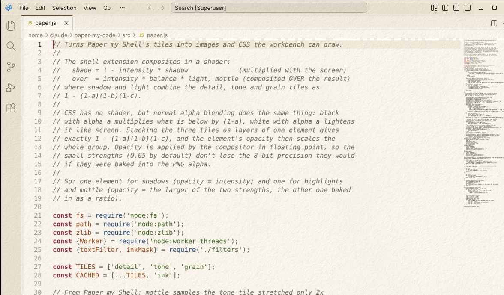
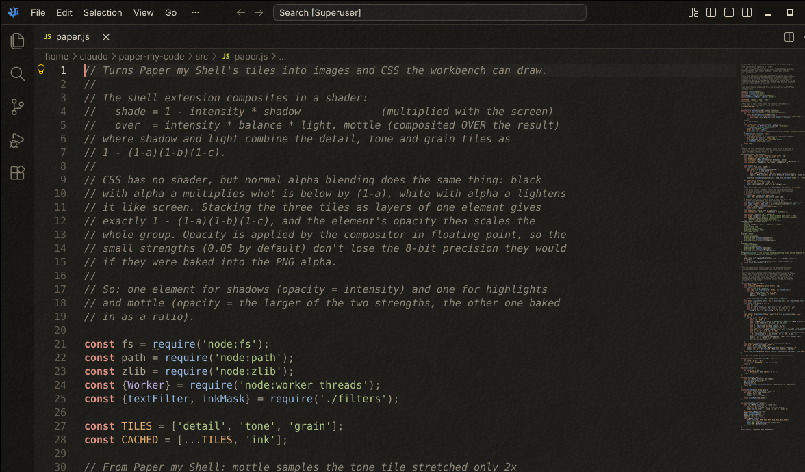

# Paper my Code

**Code that reads like print, not like a glowing panel.**

Two colour themes for [VSCodium](https://vscodium.com) and VS Code, **Paper** and **Paper Night**, set in the colours offset print can actually reach, with an optional realistic paper texture over the window.

A port of [Paper my Shell](https://github.com/coffeebowl/paper-my-shell) by coffeebowl, a GNOME Shell extension that lays paper over the whole desktop. The textures come from its generator, and the print colours from its gamut table and shader formulas.

| Paper | Paper Night |
|---|---|
|  |  |

## Features

**Themes**, installable anywhere, nothing patched:

- **Print colours**: every colour goes through Paper my Shell's 65³ lookup table for offset print on uncoated paper. Blues, violets and bright greens calm down, while reds and ochres stay strong.
- **Matte**: blacks lift towards the charcoal of real ink, and white gets a touch warmer.
- **Set like code in a book**: bold keywords, italic comments and parameters, semantic highlighting.
- **Readable**: every text colour passes WCAG AA, and body text is about 14:1 on Paper and 11.5:1 on Paper Night.
- **Adjustable**: brightness, matte and print colours are settings, and the themes are rewritten to match.

**Paper**, drawn over the workbench:

- **Seven papers** from Paper my Shell: recycled, drawing, watercolor, washi, laid paper, cardboard and canvas.
- **Paper texture**: a shaded relief of tooth, fibres and pulp formation, lit from the upper left. Shadows show on light surfaces and highlights on dark ones.
- **Ink mottle**: dark areas lighten in soft patches, where ink soaked in unevenly.
- **Ink spread** on the editor's text: strokes grow ragged where the paper takes ink.
- **Light scattering**: dark strokes get a faint halo, and light gaps between them darken a little.
- **Window or editor only**, 1x/2x resolution, adjustable scale for true size, and the texture hides when VSCodium is fullscreen.
- **Works with [background](https://github.com/shalldie/vscode-background)** by shalldie: hand the paper to that extension instead, in one command.

## Install

1. Download `paper-my-code-x.y.z.vsix` from [Releases](../../releases).
2. In VSCodium, open Extensions → `…` → **Install from VSIX…**, or run:
   ```bash
   codium --install-extension paper-my-code-x.y.z.vsix
   ```
3. Pick the theme: `Ctrl+K` `Ctrl+T` → **Paper** or **Paper Night**.

That's the theme. For the paper texture, choose one of the two ways below.

### Paper texture, built in

Run **Paper my Code: Turn On Paper** from the command palette and reload the window. The first time, each paper takes a few seconds to generate; it's cached after that. **Turn Off Paper** removes it again.

### Paper texture with the background extension

If you use shalldie's [background](https://github.com/shalldie/vscode-background) extension, install it, then run **Paper my Code: Use Paper in the Background Extension**. It renders your paper into one seamless image and fills in `background.fullscreen`. It also switches off Paper my Code's own texture so the paper isn't drawn twice.

Without Paper my Code, take the images from the release's `paper-backgrounds.zip` and set them up by hand:

```jsonc
"background.fullscreen": {
  "images": ["~/Pictures/paper/paper-drawing.png"],
  "opacity": 0.0679,           // per paper, see the zip's README; raise for a stronger paper
  "size": "2048px 2048px",
  "position": "0 0",
  "styles": [{ "background-repeat": "repeat", "mix-blend-mode": "normal", "transition": "none" }]
}
```

The `styles` line is needed. Without it, the paper is stretched instead of repeated, and on dark themes its shadows disappear.

### Print font

Themes can't set fonts. Install [IBM Plex Mono](https://github.com/IBM/plex), [Courier Prime](https://quoteunquoteapps.com/courierprime/) or [iA Writer Mono](https://github.com/iaolo/iA-Fonts), all free under the SIL Open Font License. Then run **Paper my Code: Use Print Font**:

```bash
sudo apt install fonts-ibm-plex        # Debian, Ubuntu
sudo dnf install ibm-plex-mono-fonts   # Fedora
```

## Settings

All under *Settings → Paper my Code*. Defaults are Paper my Shell's.

| Setting | Default | |
|---|---|---|
| `paperMyCode.paper` | `drawing` | Which paper |
| `paperMyCode.texture.intensity` | `0.05` | Strength of the relief, subtle on purpose |
| `paperMyCode.texture.darkBalance` | `0.4` | Strength on dark surfaces relative to light ones |
| `paperMyCode.texture.grain` | `0.5` | Pixel-fine fibres and grain |
| `paperMyCode.mottle` | `0.04` | Ink mottle |
| `paperMyCode.printColors` | `1` | How far colours move into the print gamut |
| `paperMyCode.matte` | `0.2` | Black lift; `1` is the black of uncoated paper |
| `paperMyCode.brightness` | `0.9`, off | Dims the themes |
| `paperMyCode.inkSpread` | `0.4` | Ink spread on the editor's text |
| `paperMyCode.lightScatter` | `0.6` | Light scattering on the editor's text |
| `paperMyCode.scope` | `window` | `window` or `editor` |
| `paperMyCode.resolution` | `1x` | `2x` for HiDPI displays |
| `paperMyCode.scale` | `1` | Feature size; for true size, use dpi ÷ (110 × display scaling) |

Every effect also has an `….enabled` switch.

The texture is meant to be barely noticeable, as in Paper my Shell; you feel it more than see it. If you want it plainly visible, raise `texture.intensity`, or the background extension's `opacity`, to two or three times the default.

## Troubleshooting

**"Can't write to VSCodium's install folder" / `EACCES: permission denied`.** The paper (from this extension or from the background extension) is drawn by adding a stylesheet to VSCodium's `workbench.html`, the only way to draw over the workbench. The themes don't need this.

- **System-wide .deb/.rpm installs** (`/usr/share/codium`) belong to root. Give your user the app folder:
  ```bash
  sudo chown -R "$USER" /usr/share/codium/resources/app
  ```
  A VSCodium update makes the files root's again, so run this again after updating. Afterwards, both extensions offer to put the paper back.
- **Flatpak, Snap and AppImage installs** are read-only and can't be patched. Use the [tarball](https://github.com/VSCodium/vscodium/releases) in your home folder instead.
- **Tarball, Windows and macOS installs** work as they are.

**"Installation appears to be corrupt."** Paper my Code keeps the checksum in `product.json` correct, so it doesn't cause this. Other extensions that patch VSCodium can, and the warning is harmless.

**Uninstalling.** **Turn Off Paper** restores `workbench.html` byte for byte. Uninstalling the extension does the same on the next start.

## How it works

The themes are ordinary colour themes. `src/theme.js` takes the palette in `src/palette.js` and puts every colour through Paper my Shell's print shader steps, in its order: print colour table, matte, paper tint, brightness.

The texture is two layers over the window:

- **Shadows**: black tiles whose alpha is the relief's shadows.
- **Highlights and mottle**: white tiles.

Normal alpha blending gives exactly what Paper my Shell's shader does. Black at alpha *a* multiplies what's below by (1−*a*), and white lightens it like `screen`. Each layer's CSS `opacity` carries the strength, so the GPU applies it in floating point and the subtle default strengths don't band.

Ink spread and light scattering are an SVG filter on the editor's text area. It is the one place a web page can read its own pixels.

## Limitations

- **Images and webviews:** print colours, matte and brightness apply to the themes' colours, not to images, icons and webviews as in Paper my Shell.
- **Ink spread** doesn't creep along single fibres as in the shell extension, because an SVG filter can't follow a direction per pixel.
- **The background extension takes one image,** so for it the paper's large cloudy variation is half Paper my Shell's size.
- **True size** has to be entered by hand, because VSCodium can't read the monitor's physical size.

## Development

```
src/palette.js       the themes' colours before printing
src/theme.js         print colours, matte, brightness → themes/
src/print-lut.bin    Paper my Shell's print-lut.png as raw RGB
src/paper.js         texture cache, layer baking, background image, PNG writer
src/filters.js       ink spread and light scattering (SVG filter)
src/patcher.js       workbench.html and its checksum in product.json
src/worker.mjs       runs the texture generator off the main thread
src/extension.js     commands and settings
src/uninstall.js     restores workbench.html after uninstalling
vendor/papergen.mjs  Paper my Shell's texture generator, unchanged
tools/make-backgrounds.js  writes the seven background images
```

No dependencies. Node 20 or later for the scripts:

```bash
npm run themes        # rebuild themes/ and print the contrast report
npm run backgrounds   # write paper-backgrounds/ for a release
npm run package       # build the .vsix
```

To try changes, open the folder in VSCodium and press `F5` for an Extension Development Host.

## Credits

The paper textures, print gamut table and effect formulas are from [Paper my Shell](https://github.com/coffeebowl/paper-my-shell) by coffeebowl. Its texture generator is included unchanged in `vendor/`.

## License

[GPL-3.0-or-later](LICENSE), as Paper my Shell, whose code this contains.
